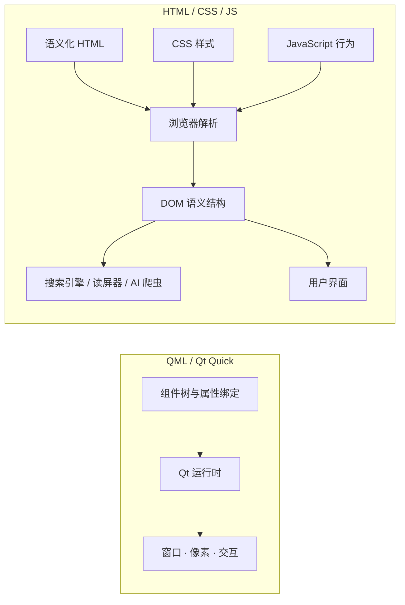
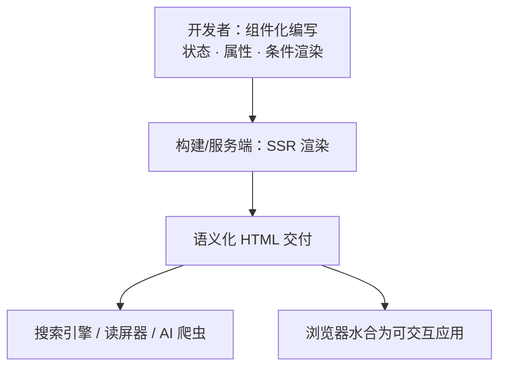

> 当 UI 是封闭应用的一部分，我们关心组件是否内聚；当 UI 是开放内容网络的一部分，我们关心语义能否被外部世界读懂。两条路线，本质上是两种系统边界下的不同最优解。


**一句话结论**：QML 交付的是**运行时界面**，HTML 交付的是**可解析的语义结构**。UI 框架怎么设计，取决于它把结构给谁看、把语义给谁用、把控制权交给谁。


## 一、HTML/CSS/JS：为开放内容而生的分工

HTML 诞生于 Web 早期，目标不是构建应用界面，而是标记**文档结构**：标题、段落、列表、链接。浏览器最初的角色也更像「文档阅读器」，而不是「应用运行容器」。

问题很快出现。HTML 本身没有为精细视觉设计提供足够表达力，于是人们开始滥用标签：用 `<font>` 改样式，用 `<table>` 拼布局。结果是结构、内容、表现混在一起，页面臃肿且难以维护。

CSS 的出现正是为了解决这个问题：**把表现从文档结构中分离出去**。HTML 保留语义结构，CSS 负责外观。后来 JavaScript 加入，负责行为与交互。于是形成了 Web 的经典分工：

| 层 | 职责 | 关键词 |
| --- | --- | --- |
| **HTML** | 内容与语义结构 | 文档、大纲、可访问性 |
| **CSS** | 表现与样式 | 布局、视觉、响应式 |
| **JavaScript** | 行为与交互 | 事件、状态、动态更新 |

这个分工不是为了语法优雅，而是因为 Web 是**开放内容平台**。页面由无数不可控的作者编写，却要被浏览器、搜索引擎、屏幕阅读器、AI 爬虫、跨平台分发系统共同消费。

浏览器为什么必须依赖 HTML 这种结构化语义？因为外部消费者往往**不执行你的 JavaScript**，也不理解你的组件树。它们只能读取服务器返回的 HTML，判断「这里是一篇文章、一个标题、一个导航」。如果内容只存在于 JS 执行之后的 DOM 里，对很多机器消费者来说，页面就是空的。

所以，HTML 的语义统一是开放 Web 的互操作契约，而不是装饰性最佳实践。

```html
<article>
  <h1>文章标题</h1>
  <p>正文内容。</p>
</article>
```

结构归 HTML，表现归 CSS。这是 Web 面对不可控内容和多方消费者的工程解。

## 二、Qt 与 QML：为应用 UI 而生的声明式层

Qt 的历史比 QML 早得多。Qt 在 1990 年代以 C++ 跨平台 GUI 框架起家，核心是 Qt Widgets：开发者用命令式 C++ 创建控件、连接信号槽、手动更新界面。它通过 `QStyle` 等机制封装不同平台的原生外观，让应用融入操作系统。

这套模型适合传统桌面应用，但随着移动端、嵌入式和动态界面需求增加，命令式 UI 的样板代码和状态同步成本越来越高。2009 年前后，Qt 引入 Qt Quick 和 QML，提供一条新的声明式 UI 路线。

QML 不是要替代 HTML，也不是独立于 Qt 的通用 Web 语言。它是 **Qt 应用的前端声明层**：QML 描述界面结构和属性绑定，C++ 后端承载业务逻辑、数据和复杂计算，两者通过属性、信号槽和可调用方法通信。

QML 的核心语法特征：

- 对象树声明界面结构；
- 属性绑定让 UI 自动跟随状态；
- 信号与处理器表达交互；
- 允许开发者自定义组件；
- **对象声明中不能使用原生 `if`/`for` 控制流来动态包裹组件**，条件 UI 通过 `visible`、`Loader`、`State` 等声明式机制表达。

```qml
Rectangle {
    width: 200; height: 100

    Text {
        anchors.centerIn: parent
        text: "Count: " + count
    }

    // 不能写 if (condition) { Rectangle { ... } }
    // 条件 UI 用 visible、Loader 或 State 表达
}
```

QML 的组件是结构、样式、行为的统一体。一个 `MyButton.qml` 可以封装品牌样式、内部结构和交互逻辑，外部只暴露简洁接口。这在封闭应用内部非常高效。

## 三、核心区别：交付物不同

QML 和 Web 最根本的区别，不是语法，而是**最终交付给外部世界的是什么**。

- **QML 交付的是运行时界面和像素**。应用内部结构清晰，IDE 可分析、可跳转，但外部系统看到的是窗口，而不是可解析的文档结构。
- **HTML 交付的是可解析的文本结构**。搜索引擎、屏幕阅读器、AI 爬虫和其他系统可以直接读取语义。




QML 并非「没有语义结构」，而是它的结构主要是**面向开发者的内部语义**；HTML 的语义则是**面向外部消费者的交付语义**。


这也解释了两者对组件自定义的不同态度：

| 维度 | QML / Qt Quick | HTML / CSS / JS |
| --- | --- | --- |
| 设计目标 | 封闭应用的界面 | 开放内容的呈现 |
| 交付物 | 运行时界面与像素 | 可解析的语义化文档 |
| 语义面向 | 开发者（内部结构） | 外部消费者（搜索、读屏、爬虫） |
| 组件策略 | 自由自定义，封装优先 | 固定语义标签，互操作优先 |
| 样式组织 | 组件内聚，结构与样式统一 | CSS 与结构分离 |

- QML 允许自定义组件，因为应用是自包含系统，封装能力比全球语义统一更重要；
- HTML 坚持固定语义标签，因为开放内容需要跨组织、跨系统的互操作。

## 四、思想实验：如果重新设计浏览器，会不会选择 QML 这种方式？

答案是：**取决于浏览器想服务什么。**

### 情况一：浏览器只用来跑 Web App

如果重新设计的浏览器只承载 Figma、在线文档、SaaS 后台这类应用，那么 QML 模式大概率更有优势：

- 声明式对象树和属性绑定让 UI 自动跟随状态；
- 结构、样式、行为在组件级别内聚，组件封装能力强；
- 没有 CSS 级联和全局样式冲突；
- 渲染路径更短，性能更可控。

在这个场景下，QML 式的组件模型是很自然的选择。

### 情况二：浏览器还要浏览开放文档

如果浏览器仍然要承载新闻、博客、论文、维基这类开放内容，那么抛弃 HTML 语义和 CSS 分离会带来严重问题：

- 读者无法用自定义样式覆盖全网内容；
- 同一份内容难以适配手机、打印、屏幕阅读器和不同阅读模式；
- 搜索引擎和 AI 爬虫难以理解页面内容；
- 写作者门槛会急剧升高，因为不是每个人都愿意用组件和属性绑定来写文章。

在这种情况下，HTML 的固定语义标签和 CSS 的表现分离不是历史包袱，而是开放内容平台的生存机制。

| 浏览器定位 | 更合适的模型 | 关键理由 |
| --- | --- | --- |
| 只跑 Web App | QML 式声明式组件 | 封装强、状态绑定自然、渲染路径可控 |
| 还要承载开放文档 | HTML 语义 + CSS 分离 | 可覆盖、可适配、可被机器理解 |


如果重造的是一个只跑应用的浏览器，QML 模式可能更好；如果重造的是承载开放信息网络的浏览器，HTML/CSS 分离大概率会以另一种形式被重新演化出来。

Web 没有选择 QML 的路，不是因为 QML 不好，而是因为 Web 的使命比「写 App」宏大得多。


### 延伸：能不能用新语言替换 JavaScript？

浏览器即使重造，脚本层也很难重来。既然 React/Vue 的复杂度让人不满，为什么不设计一门更优雅的语言，直接原生输出 UI、替代 JavaScript？

#### 1. 浏览器原生只认 JavaScript

浏览器可以直接执行的脚本语言只有 JavaScript。任何新语言要么编译到 JavaScript，要么编译到 WebAssembly，不存在「浏览器原生执行一门新 UI 语言」的路径。

#### 2. 替换 JS 的真正壁垒

- **网络效应**：JavaScript 拥有数千万开发者和海量 npm 生态。新语言面临「没开发者—没库—没用户」的冷启动死局。
- **向后兼容**：Web 的核心原则是「不破坏现有网页」。新语言必须能完美解析和执行过去三十年积累的 JS 代码，工程上近乎不可能。
- **引擎沉没成本**：V8 等引擎经过十余年投入，性能接近原生；浏览器厂商没有动力为新语言重造一套同等水准引擎并长期双维护。

#### 3. 两次关键压力测试

**Dart** 是最直接的证据。Google 曾计划在 Chrome 内置 Dart VM，最终放弃，退回「编译到 JS」的路线。连控制 Chrome 的 Google 都无法强行推广新语言，说明生态惯性极强。

**WebAssembly** 允许 C++、Rust 等编译到浏览器运行，但它被有意设计为与 JavaScript 互补，而非替代。UI 层的主导权仍在 JavaScript 手中。

#### 4. 更现实的方向：把桥接移到编译时

React/Vue 的很多「丑陋」，是在浏览器只认 JS 的约束下做**运行时桥接**的代价。Svelte 等方案把响应式编译掉，而不是在运行时模拟：

```svelte
<script>
  let count = 0;
  $: doubled = count * 2;
</script>

<button on:click={() => count++}>
  {count} / {doubled}
</button>
```

没有 `useState`、没有依赖数组、没有虚拟 DOM。编译器分析依赖并生成精确更新代码。这证明「比 React/Vue 更优雅」是可能的，但「原生替代 JS 直接操作 UI」在开放 Web 架构下大概率走不通。


「没人想换 JS」是错觉。想换的人很多，但 Web 作为开放平台，**「统一」的价值压倒了「语言优雅」的价值**。现实路径是在 JS 之上寻找更优雅的抽象，或把计算密集型逻辑移到 Wasm，而不是原生替代 JS 来直接操作 UI。


## 五、现代框架的折中：组件式开发，语义化交付

今天的 React/Vue 生态正在出现一个值得注意的折中趋势。

一方面，内容类平台也在**应用化**。博客、文档站、新闻站越来越多地采用 React/Vue 组件开发，页面由组件树组织，状态驱动视图更新，开发习惯明显向 QML 这类声明式 UI 框架靠近：组件封装、属性传递、状态绑定、条件渲染，都是应用式思维。

另一方面，为了保住 HTML 的语义结构和外部可消费性，这些框架又越来越推崇**服务端渲染（SSR）**。Next.js、Nuxt 的核心价值之一，就是在服务器上生成带有真实内容的语义化 HTML，再交给浏览器水合为可交互应用。React Server Components 也在朝同一方向推进。

于是最终方向可能不是「二选一」，而是一种分层折中：

- **开发习惯靠近 QML 式组件化**：用组件封装结构、样式和交互，状态驱动 UI；
- **展示层保留 HTML 语义结构化**：通过 SSR 输出可被搜索引擎、屏幕阅读器、AI 爬虫理解的 HTML。

换句话说，开发者写的是组件，交付给外部世界的仍然是可以解析的语义文档。Web 没有放弃 HTML 的语义契约，而是把组件化的开发体验架在了语义化交付之上。



## 结语

QML 和 Web 不是谁替代谁，而是两种系统边界下的不同最优解。

当 UI 是封闭应用的一部分，外部世界不需要理解组件树时，QML 式声明式组件内聚是高效的。当 UI 是开放内容网络的一部分，信息需要被不可控的外部系统理解、引用、适配和消费时，HTML 的语义统一和 CSS 的表现分离仍然不可替代。

JavaScript 的替换难题也是同一个道理：技术上的「更优雅」并不足够，开放 Web 的兼容性、生态和统一性构成了更强的约束。

真正值得记住的是：

> **UI 框架的设计选择，最终取决于它把结构给谁看、把语义给谁用、把控制权交给谁。**
