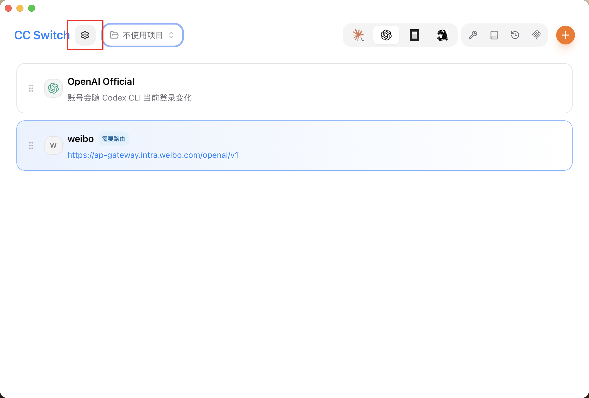
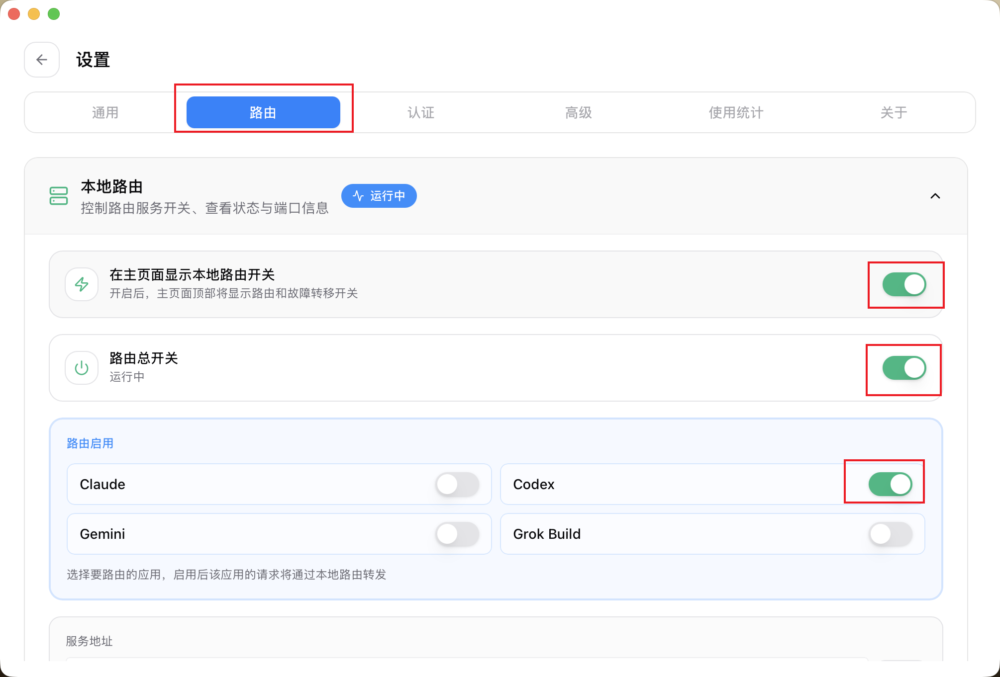
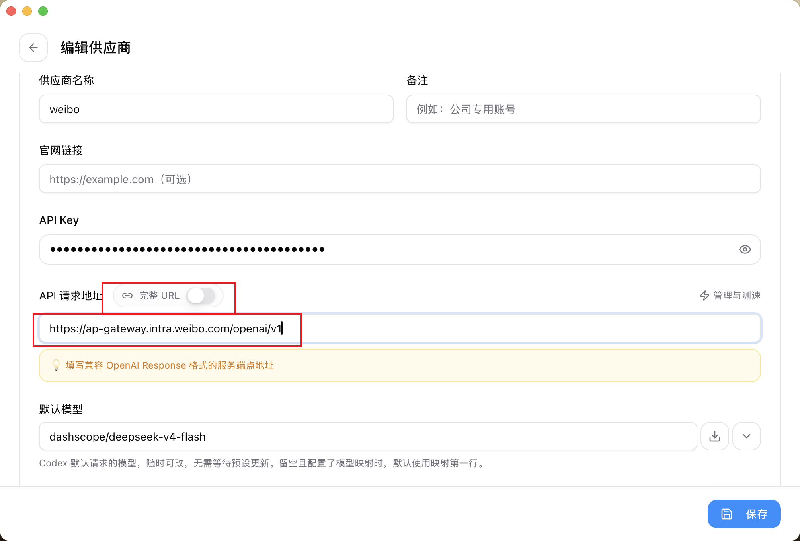
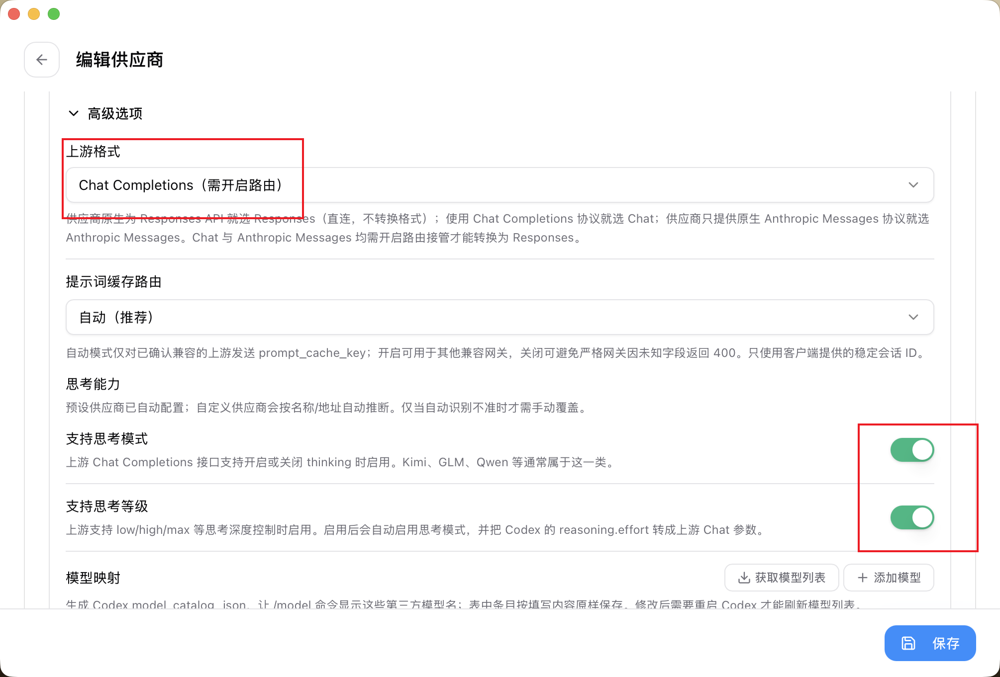
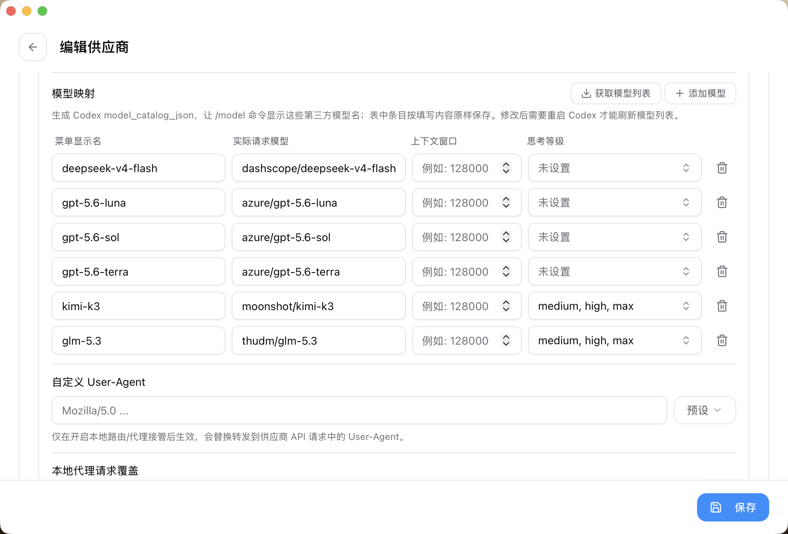

## 背景

微博内部的大模型网关 **WeiboAP**（`https://ap-gateway.intra.weibo.com/openai`）提供了 OpenAI 兼容的 API 接口，但它只支持 **Chat Completions** 协议，不支持 OpenAI 较新的 **Responses API**。

而 Codex CLI 等新一代客户端默认使用 Responses API 发起请求，直接配置 WeiboAP 作为供应商会导致协议不兼容。**CC Switch** 的本地路由功能可以解决这个问题：它在本地启动一个代理服务，将客户端发出的 Responses 请求转换为 Chat Completions 格式再转发给上游。

## 配置步骤

### 第一步：开启路由功能

打开 CC Switch 主界面，点击左上角的齿轮图标进入 **设置** 页面：



进入后切换到 **路由** 标签页：



需要确保以下三项均已开启：

- **在主页面显示本地路由开关** — 方便快速切换
- **路由总开关** — 本地代理服务的总开关
- **Codex 路由启用** — 因为我们是为 Codex 配置路由，所以需要开启此项（Claude、Gemini 等按需开启）

开启后主页面上会出现 weibo 供应商卡片，并标注 **「需要路由」**。

### 第二步：添加 WeiboAP 供应商

点击 weibo 供应商卡片进入编辑页面，填写基本信息：



| 字段 | 值 |
|---|---|
| 供应商名称 | `weibo` |
| API Key | 填写从 WeiboAP 获取的密钥 |
| API 请求地址 | `https://ap-gateway.intra.weibo.com/openai/v1` |
| 默认模型 | `dashscope/deepseek-v4-flash` |

> WeiboAP 的网关基础地址为 `https://ap-gateway.intra.weibo.com/openai`，在 CC Switch 路由模式下需要在末尾手动追加 `/v1` 后缀，最终填入的完整地址为 `https://ap-gateway.intra.weibo.com/openai/v1`。
>
> 注意：「完整 URL」开关保持关闭。CC Switch 会自动拼接路径前缀。

### 第三步：设置上游格式为 Chat Completions

展开 **高级选项**，将 **上游格式** 设置为 **Chat Completions（需开启路由）**：



这一步是核心——它告诉 CC Switch：WeiboAP 只理解 Chat Completions 协议，需要由路由层完成协议转换。

同时根据模型能力，还可以开启：
- **支持思考模式** — 启用后自动将 Codex 的 `reasoning.effort` 参数转为上游 Chat 参数
- **支持思考等级** — 支持 low/high/max 等思考深度控制

### 第四步：配置模型映射

继续向下滚动到 **模型映射** 区域，配置第三方模型名到 WeiboAP 实际模型名的映射关系：



示例映射如下：

| 菜单显示名 | 实际请求模型 | 思考等级 |
|---|---|---|
| `deepseek-v4-flash` | `dashscope/deepseek-v4-flash` | 未设置 |
| `gpt-5.6-luna` | `azure/gpt-5.6-luna` | 未设置 |
| `gpt-5.6-sol` | `azure/gpt-5.6-sol` | 未设置 |
| `gpt-5.6-terra` | `azure/gpt-5.6-terra` | 未设置 |
| `kimi-k3` | `moonshot/kimi-k3` | medium, high, max |
| `glm-5.3` | `thudm/glm-5.3` | medium, high, max |

模型映射的作用是让 Codex 的 `/model` 命令能显示这些友好的模型名称，实际请求时再转换为 WeiboAP 所需的完整模型标识。对于支持思考的模型（如 kimi-k3、glm-5.3），可以额外配置可用的思考等级。

## 工作原理

```
Codex CLI (Responses API)
    ↓
CC Switch 本地路由 (协议转换: Responses → Chat Completions)
    ↓
WeiboAP 网关 (Chat Completions API)
    ↓
各模型后端 (DeepSeek / Azure OpenAI / Moonshot / 智谱 等)
```

CC Switch 在本地监听一个端口，拦截 Codex 发出的 Responses 格式请求，将其改写为 Chat Completions 格式后转发给 WeiboAP，再将响应原路返回给客户端。整个过程对 Codex 完全透明。
