## 结论摘要

C12 集群频繁发生 ISR Shrinking，直接原因是 Follower Fetch 链路出现秒级延迟，导致副本未能在 `replica.lag.time.max.ms` 指定的时间内完成同步，被 Leader 移出 ISR。

逐层排查后确认，延迟并非由磁盘、Kafka 日志写入或 Fetch 请求参数导致，而是宿主机内核的 cgroups 泄漏 Bug 所致。该 Bug 会在读取 cgroups 数据时长时间关闭中断，影响虚拟机的线程调度与定时唤醒，使 Kafka 时间轮和 `ReplicaFetcherThread` 出现秒级停顿。升级受影响机器的内核后，相关指标恢复正常，连续观察数天未再出现 ISR Shrinking。

## 问题背景

### 故障现象

Grafana 监控显示，C12 集群多个 Broker 的 `IsrShrinksPerSec` 频繁出现尖峰，说明 ISR 收缩不是单节点、单分区的偶发事件。

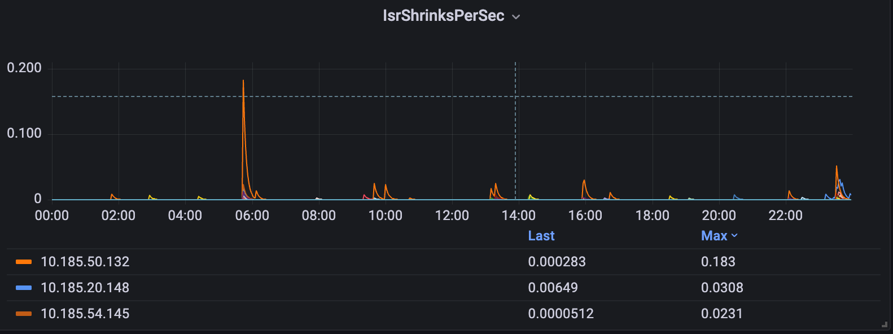

ISR Shrinking 表示 Follower 被 Leader 移出同步副本集合。频繁发生时会降低 ISR 的稳定性；如果同一分区的多个副本同时退出 ISR，还会削弱分区的冗余与容灾能力。

### 关键配置

| 配置项 | 配置值 | 本次排查中的作用 |
| --- | ---: | --- |
| `replica.lag.time.max.ms` | `5000` | Follower 同步滞后超过该时间窗口后，可能被移出 ISR |
| `replica.fetch.min.bytes` | `10240` | Follower Fetch 请求期望返回的最小字节数；数据不足时 Leader 会延迟响应 |
| `replica.fetch.max.bytes` | `1048576` | Follower 单次 Fetch 请求允许返回的最大字节数 |
| `replica.fetch.wait.max.ms` | `300` | 数据不足 `replica.fetch.min.bytes` 时，Leader 延迟响应的最长等待时间 |

## 排查过程

### 1. 检查基础监控，暂排除磁盘问题

首先检查 Broker 的常规监控，未发现能够直接解释 ISR Shrinking 的明显异常。参考 C13 集群的历史排查经验，进一步收集 flush 及其他磁盘相关指标，检查是否存在刷盘或 I/O 阻塞。

检查结果显示，flush 及其他磁盘指标均无明显异常，暂未发现磁盘 I/O 导致副本同步延迟的证据，因此将排查方向转向 Follower Fetch 链路。

### 2. 梳理 Follower Fetch 与 ISR 收缩的关系

Follower 的副本同步流程如下：

1. Follower 通过 `ReplicaFetcherThread` 向 Leader 持续拉取数据，线程循环执行 `doWork`。
2. `ReplicaFetcherThread` 通过 `buildFetch` 构建 Fetch 请求，再通过 `fetch` 同步发送请求并接收响应。
3. Leader 处理 `FetchFollower` 请求，更新 Follower 的同步状态并返回数据。
4. Follower 调用 `processPartitionData` 处理响应，将数据追加到本地日志并更新日志末端偏移量（LEO）。

`replica.lag.time.max.ms` 是 Leader 判断副本是否跟得上同步的重要时间窗口。如果 Follower 长时间没有发送 Fetch 请求，或者没有追赶上 Leader 的日志末端，就可能被移出 ISR。因此，Follower 线程调度、网络传输、Leader 请求处理和本地日志写入中的任一环节发生长时间阻塞，都可能最终表现为 ISR Shrinking。

### 3. 定位 Follower 侧的慢请求

选取 ISR Shrinking 最频繁的几台节点，使用 Arthas 监控 `AbstractFetcherThread.doWork` 的耗时。由于 ISR Shrinking 难以精确复现，先通过慢调用过滤确认 Fetch 链路是否存在异常。

通常情况下，`doWork` 的平均耗时约为 100 ms。过滤耗时超过 1000 ms 的调用后，捕获到一次耗时 `2131.73 ms` 的请求。

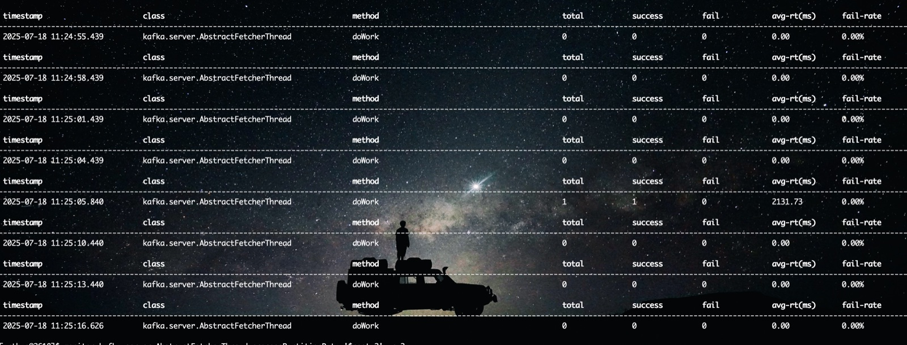

单次 `2131 ms` 仍低于 `replica.lag.time.max.ms=5000`，不能单独解释 ISR 收缩，但相比约 100 ms 的常态耗时已经明显异常，说明 Fetch 链路确实存在秒级延迟。

`doWork` 的核心工作可以拆分为两个阶段：

1. `buildFetchRequest`：构建 Fetch 请求。
2. `processFetchRequest`：发送请求、处理响应并写入本地日志。

继续监控后发现，`buildFetchRequest` 耗时很短，异常主要集中在 `processFetchRequest`，多次调用耗时超过 2 秒。

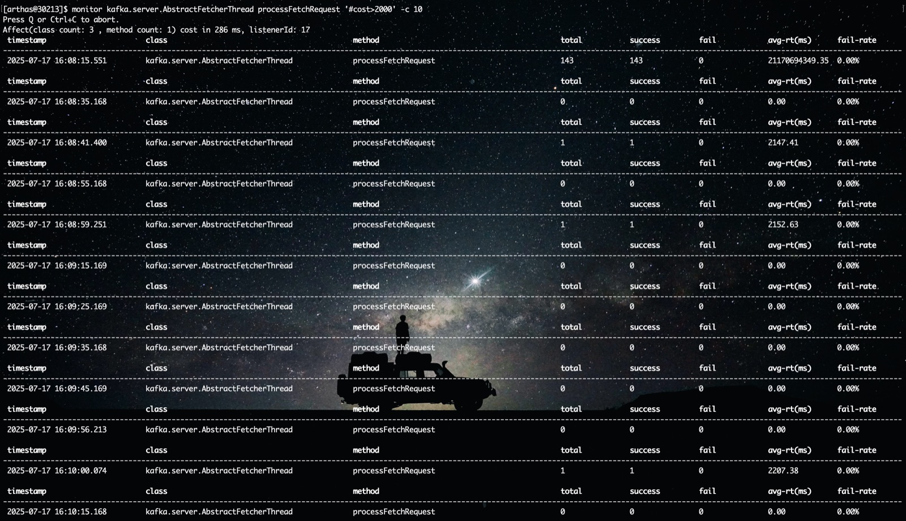

`processFetchRequest` 又包含“向 Leader 发送 Fetch 请求”和“将数据写入本地日志”两个主要步骤。对 `ReplicaFetcherThread.fetch` 单独监控后，发现慢请求的主要耗时同样集中在 Fetch 请求阶段，而不是本地日志写入阶段。

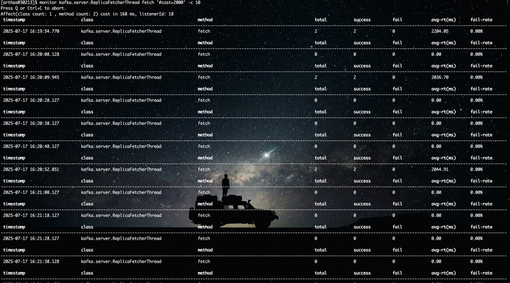

至此，可以将问题范围缩小到 Fetch 请求的网络传输或 Leader 端处理过程，并通过 Leader 端指标继续定位。

### 4. 通过 Leader 指标定位到 RemoteTime

使用 JMX Exporter 采集 Leader 处理 `FetchFollower` 请求的分阶段耗时指标。

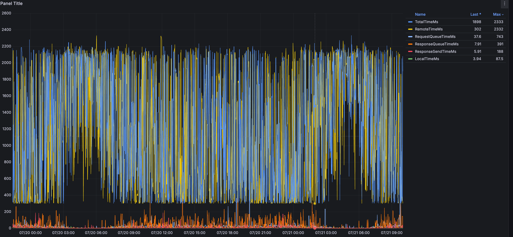

监控中可以看到：

- `TotalTimeMs` 与 `RemoteTimeMs` 基本同步升高，最大值分别约为 `2333 ms` 和 `2332 ms`。
- `LocalTimeMs` 最大仅约 `87.5 ms`，不是主要耗时来源。
- `RequestQueueTimeMs`、`ResponseQueueTimeMs` 和 `ResponseSendTimeMs` 虽然也有波动，但无法解释主要的秒级延迟。

对于 `FetchFollower` 请求，`RemoteTimeMs` 主要表示请求在延迟 Fetch 机制中的等待时间，而不是网络传输时间。当可读数据不足 `replica.fetch.min.bytes` 时，Leader 会将请求放入 Delayed Fetch，等待数据达到要求或等待超时。

按照 `replica.fetch.wait.max.ms=300` 的配置，数据不足时的正常等待时间通常应在 300 ms 左右，再加少量调度和处理开销，不应频繁达到 2 秒以上。因此，下一步重点检查负责 Delayed Fetch 超时的 Kafka 时间轮。

### 5. 确认 Kafka 时间轮未能按时推进

Kafka 的 `SystemTimer.advanceClock` 会通过 `DelayQueue.poll` 等待时间轮任务，源码中的等待时间为 200 ms。使用 Arthas 过滤耗时超过 1000 ms 的调用后，发现 `advanceClock` 多次出现秒级耗时，部分统计窗口的平均耗时达到 `1276.57 ms`、`1898.83 ms`。

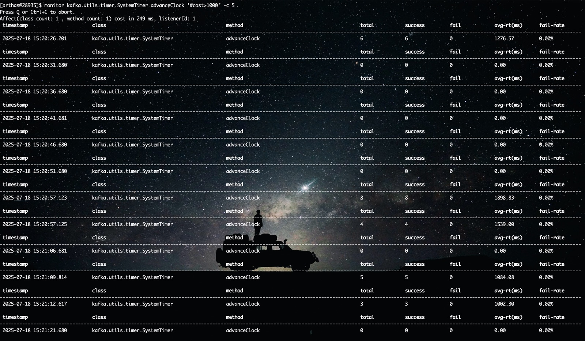

进一步使用 `trace` 拆分 `advanceClock` 的内部调用，一次总耗时 `2066.62 ms` 的调用中，`DelayQueue.poll` 占用了约 `2066.58 ms`，几乎全部异常耗时都发生在等待阶段，而不是时间轮任务执行阶段。

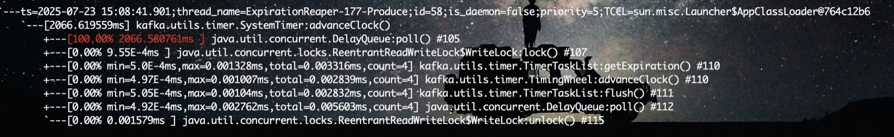

继续跟踪 JDK 方法，捕获到一次 `DelayQueue.poll` 耗时 `1945.91 ms`，其中 `Condition.awaitNanos` 耗时 `1945.82 ms`。

```bash
trace --skipJDKMethod false java.util.concurrent.DelayQueue poll '#cost > 1000' -n 1
```

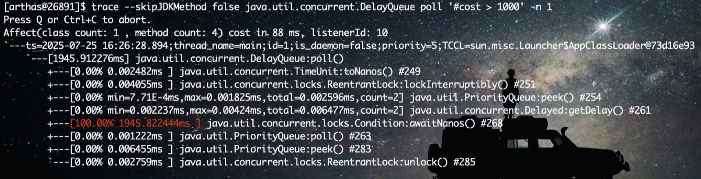

调用链最终落到 JDK 的定时等待。`Condition.awaitNanos` 底层主要通过 `LockSupport.parkNanos` 实现。Arthas 无法继续向 JVM 底层追踪，因此需要通过独立 Demo 验证：脱离 Kafka 后，定时等待是否仍然会出现同样的超时。

### 6. 使用独立 Java Demo 复现定时唤醒延迟

编写一个最小 Java Demo：循环调用 `LockSupport.parkNanos` 等待 200 ms，实际耗时超过 500 ms 时打印一条记录。该程序不依赖 Kafka，也不涉及磁盘 I/O。

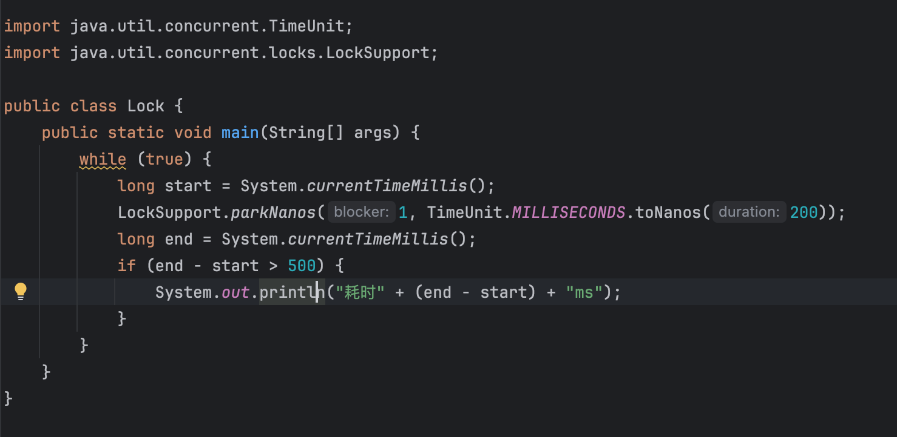

正常环境下可能因调度产生少量抖动，但不应持续出现秒级延迟。在问题服务器上运行时，Demo 多次打印异常记录，单次等待耗时达到 `813 ms` 至 `2103 ms` 不等。

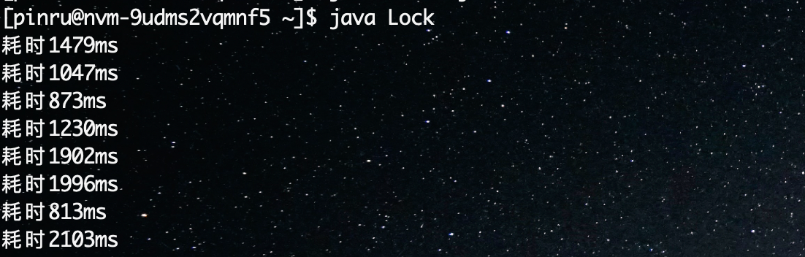

这说明问题可以脱离 Kafka 独立复现，Kafka 的时间轮实现和副本同步逻辑不是根因。继续检查 JVM 的 GC、内存等指标，也未发现异常，排查范围进一步转向线程调度、操作系统及虚拟化层。

随后通过 `strace` 和线程上下文切换数据观察 Demo：

- `strace` 显示线程长时间停留在 `futex` 等待中。
- 记录到 6 次主动上下文切换和 2 次非主动上下文切换，而 Demo 已打印 68 次异常记录。
- 未观察到与每次异常一一对应的额外系统调用或频繁上下文切换。

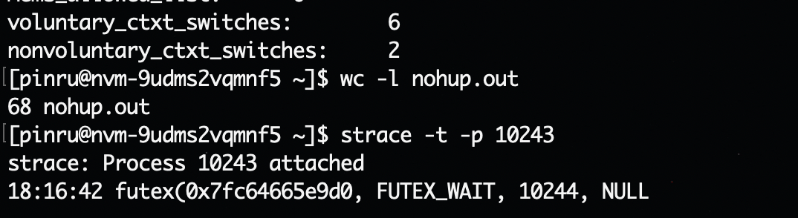

这些现象不能用于排除操作系统问题，反而说明线程没有按预期被唤醒和继续执行。考虑到 Broker 运行在虚拟机中，最终联系 NVM 团队协同排查宿主机。

### 7. 确认宿主机内核根因

NVM 团队最终确认，问题来自宿主机内核的 cgroups 泄漏 Bug。该 Bug 被触发后，系统读取 cgroups 数据时会长时间关闭中断，影响整个系统的延迟与响应。

相关内核补丁：

[Linux 内核补丁：NVM 团队提供的修复参考](https://patchwork.kernel.org/project/linux-block/patch/20230609234249.1412858-1-ming.lei@redhat.com/)

这一结论与前面的所有现象一致：Kafka 时间轮和普通 Java Demo 都出现定时等待超时，但 Kafka 日志写入、JVM GC、内存和磁盘指标均没有对应异常。

## 根因分析

### 完整因果链

1. 宿主机触发 cgroups 泄漏 Bug，读取 cgroups 数据时长时间关闭中断。
2. 相关虚拟机的 vCPU 和线程无法及时调度或处理定时唤醒，表现为 JVM 线程被短暂“冻结”，停顿时间从数百毫秒到数秒不等。
3. 如果停顿发生在 Leader 侧，Kafka 时间轮无法按时推进，Delayed Fetch 不能按 `replica.fetch.wait.max.ms` 配置及时超时返回，导致 `RemoteTimeMs` 和整个 Fetch 请求耗时升高。
4. 如果停顿发生在 Follower 侧，`ReplicaFetcherThread` 无法及时发送 Fetch 请求或处理响应，副本同步同样会延迟。
5. Leader 或 Follower 的停顿可能持续或重复发生。当副本在整个 `replica.lag.time.max.ms=5000` 时间窗口内未能正常同步时，Leader 将 Follower 移出 ISR，形成监控中的 ISR Shrinking。

因此，单次 Fetch 耗时约 2.1 秒与 5 秒的 ISR 判定阈值并不矛盾：前者证明链路存在异常，后者是副本持续或反复无法正常同步后的最终结果。

### 排查结论汇总

| 排查对象 | 观测结果 | 结论 |
| --- | --- | --- |
| 磁盘与 flush 指标 | 未见明显异常 | 没有证据表明磁盘 I/O 是本次问题主因 |
| Follower 本地日志写入 | 主要耗时不在写入阶段 | 排除其为主要延迟来源 |
| Leader `FetchFollower` 指标 | 总耗时主要集中在 `RemoteTimeMs` | 延迟发生在 Delayed Fetch 等待阶段 |
| Kafka `SystemTimer` | `advanceClock` 多次超过 1 秒 | 时间轮未能按 200 ms 的等待周期正常推进 |
| JDK `DelayQueue.poll` | 耗时集中在 `Condition.awaitNanos` | 异常位于定时等待及唤醒过程 |
| 独立 Java Demo | 脱离 Kafka 后仍出现秒级 `parkNanos` | Kafka 业务逻辑不是根因 |
| JVM GC 与内存 | 未见异常 | 没有证据表明 JVM GC 或内存问题导致停顿 |
| 宿主机内核 | NVM 团队确认 cgroups 泄漏 Bug | 最终根因 |

## 修复与验证

2025 年 7 月 28 日，配合 NVM 团队选择一台受影响机器停机升级内核。升级完成后：

- Fetch 及时间轮相关指标恢复正常。
- 持续观察数天，未再出现 ISR Shrinking。
- 修复结果与宿主机内核 Bug 的根因判断一致。

NVM 团队随后提供了存在相同问题的机器列表，其中 Kafka 涉及 174 台机器。除已验证修复的机器外，其余节点需要与 NVM 团队继续制定并执行修复计划，避免问题在其他 Broker 上复发。

## 后续改进

1. **完成受影响机器治理**：根据 NVM 团队提供的清单推进 174 台 Kafka 相关机器的内核修复，并在每批修复后观察 ISR 和 Fetch 指标。
2. **完善监控与告警**：持续关注 `IsrShrinksPerSec`、`FetchFollower` 的 `TotalTimeMs`、`RemoteTimeMs`、`RequestQueueTimeMs` 和 `LocalTimeMs`，同时补充宿主机及虚拟机调度延迟相关指标。
3. **保留最小复现方法**：将 `LockSupport.parkNanos` Demo 作为类似问题的快速验证手段，用于区分 Kafka 内部逻辑问题与底层线程调度问题。
4. **避免仅通过调大阈值规避**：在根因未明确前，不应简单调大 `replica.lag.time.max.ms`。这只能延后 ISR 判定，无法消除底层停顿，还可能掩盖真实的副本同步故障。

## 经验总结

- Kafka 请求的分阶段指标能够快速缩小范围。本次正是通过 `TotalTimeMs` 与 `RemoteTimeMs` 的对应关系，将问题从整个 Fetch 链路定位到 Delayed Fetch。
- `parkNanos`、`awaitNanos` 等定时等待显著超过预期时，除了检查应用代码，还应关注 JVM 外部的线程调度、虚拟机及宿主机状态。
- 最小化复现是跨层定位的关键。独立 Java Demo 复现相同延迟后，可以有效避免继续在 Kafka 副本同步和时间轮代码中排查。
