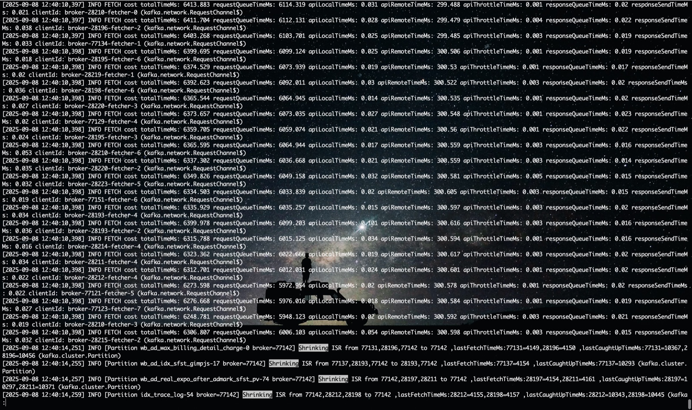
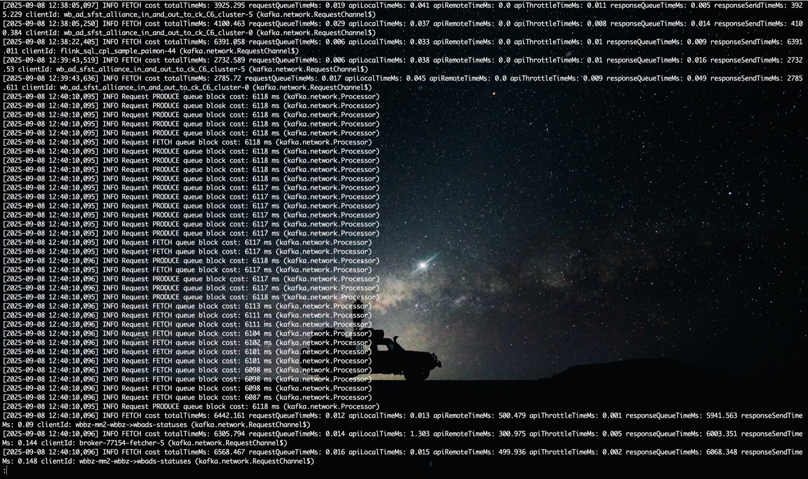
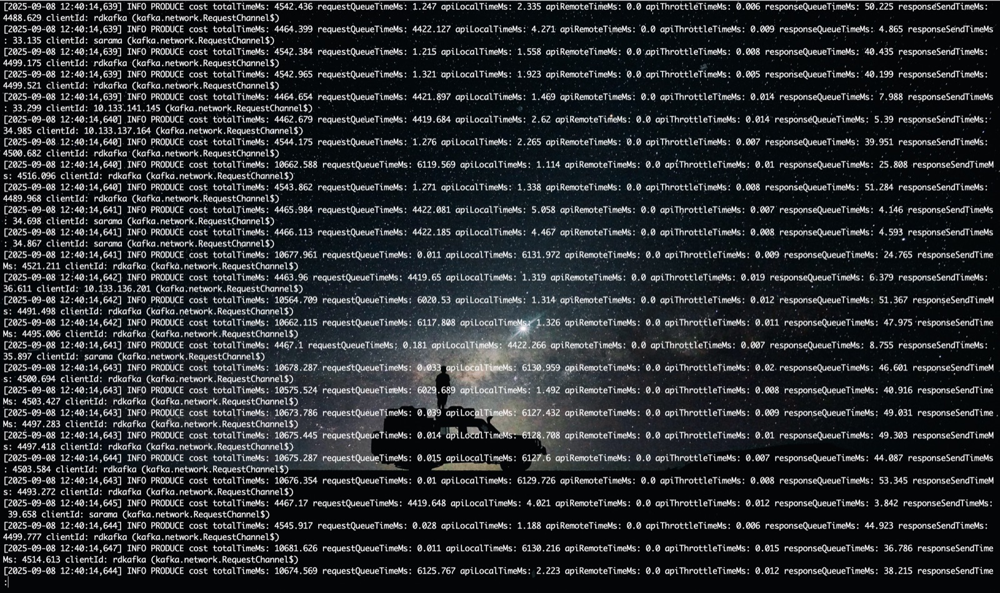
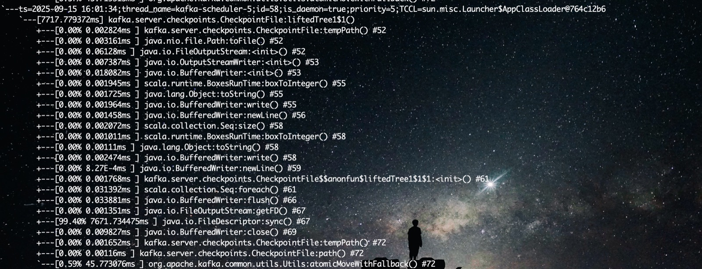

## 问题概述

ads 集群出现较频繁的 ISR Shrinking。排除已知故障原因后，通过补充请求处理、锁等待和日志刷盘耗时日志，并使用 Arthas 与 `sar` 交叉验证，最终定位到以下阻塞链路：

> `deleteSegment` 触发 `leader-epoch-checkpoint` 同步刷盘，磁盘高负载导致 `sync` 长时间阻塞；`Log` 锁因此无法及时释放，进而造成 PRODUCE 请求、I/O 线程、RequestQueue 和 Processor 线程逐级阻塞，最终因 FollowerFetchRequest 处理不及时而触发 ISR Shrinking。

**根因要点：**

- **直接原因**：`leader-epoch-checkpoint` 文件执行 `sync` 时耗时过长。
- **放大条件**：SSD Cache 集群向机械盘快速写入完整 Segment，磁盘 I/O 达到瓶颈，延长了刷盘等待时间。
- **关键缺陷**：慢速磁盘操作发生在 `Log` 锁保护范围内，单分区的刷盘阻塞进一步演变为 Broker 级请求处理阻塞。
- **修复状态**：已在内部 Kafka 1.1.1 版本中实现补丁，并选取两台 Broker 灰度观察。

## 排查过程

### 1. 拆分 FollowerFetchRequest 各阶段耗时

排除已知故障原因后，首先增加 FollowerFetchRequest 各处理阶段的耗时日志，确认请求主要阻塞在哪个环节。

从日志可以看到，FollowerFetchRequest 的主要耗时集中在 `requestQueue`，继续向前检索还能发现 `responseQueue` 耗时较长的记录。这说明请求在队列中等待的时间异常，而不是单纯消耗在业务处理阶段。

该现象与 common 集群此前出现的 Processor 线程阻塞较为相似，但两者触发原因不同：

- ads 集群同期没有 `Processor.poll` 长耗时日志，不符合 common 集群冷读问题的特征。
- ads 集群已拆分 Listener，其他链路的冷读不会直接影响处理 FollowerFetchRequest 的 Processor 线程。

因此，初步怀疑 Processor 并非阻塞在网络轮询，而是在向已满的 `requestQueue` 投递请求时发生阻塞。

### 2. 确认 Processor 阻塞在 RequestQueue

针对上述假设补充日志后，在同一次 ISR Shrinking 期间抓到了 Processor 向 RequestQueue 投递请求时的阻塞记录。

> 以下截图均在补充日志后采集，与前述 ISR Shrinking 属于同一次事件。

由此确认：Processor 阻塞的直接原因是 RequestQueue 已满。RequestQueue 的消费方是 I/O 线程（RequestHandler），队列持续积压说明 I/O 线程未能及时处理请求，下一步需要定位 I/O 线程的阻塞点。

### 3. 定位 I/O 线程阻塞在 PRODUCE 请求

继续补充 I/O 线程处理请求的耗时日志，并筛出 `apiLocalTime > 0` 的记录。

耗时记录均指向 PRODUCE 请求。PRODUCE 请求的核心处理逻辑是向日志追加数据，因此继续对 `append` 方法增加分阶段耗时日志，重点观察锁等待和实际写入耗时。

### 4. 确认 append 阻塞在等待 Log 锁

日志显示，ISR Shrinking 发生时，`append` 主要阻塞在获取 `lock` 的阶段，说明有线程长时间持有 `Log` 锁。

关联同一时间窗口的分区日志后发现，每次 `append` 阻塞前，对应分区都执行了 `deleteSegment`。因此将排查重点转向 Segment 删除流程，怀疑该流程在持有 `Log` 锁期间执行了耗时操作。

### 5. 逐层定位到 leader-epoch-checkpoint 刷盘

对 `deleteSegment` 内部调用继续拆解后，确认：

1. `maybeIncrementLogStartOffset` 耗时较长。
2. 其主要耗时来自 `leaderEpochCache.clearAndFlushEarliest`。
3. 该方法会更新并刷写 `leader-epoch-checkpoint` 文件。

随后使用 Arthas 观测 `clearAndFlushEarliest` 耗时超过 1 秒的调用，最终抓到其阻塞在文件 `sync` 操作上。

结合同期 `sar` 监控，该分区所在磁盘的 I/O 利用率已达到 100%，并且存在持续写入。至此，`sync` 长耗时与磁盘高负载在时间上能够相互印证，阻塞根因基本确定。

## 根因分析

### 1. 完整阻塞链路

本次 ISR Shrinking 的传导过程如下：

1. Segment 删除时，`deleteSegment` 调用 `maybeIncrementLogStartOffset`，进而执行 `leaderEpochCache.clearAndFlushEarliest`。
2. `clearAndFlushEarliest` 刷写 `leader-epoch-checkpoint` 文件时执行 `sync`；恰逢磁盘高负载及 dirty page 集中回写，`sync` 长时间无法返回。
3. 上述操作发生在 `Log` 锁保护范围内，导致 `deleteSegment` 长时间持有锁，其他线程的 PRODUCE 请求在 `append` 阶段等待同一把锁。
4. 大量 I/O 线程因此被占用，无法继续消费 RequestChannel 中的请求，RequestQueue 持续积压直至写满。
5. RequestQueue 满后，Processor 无法继续投递新请求并发生阻塞，服务端无法及时处理 FollowerFetchRequest。
6. Follower 拉取请求处理延迟，最终触发 ISR Shrinking。

因此，**磁盘高负载是诱发条件，锁内执行慢速 `sync` 是将局部 I/O 抖动放大为 ISR Shrinking 的关键原因**。

### 2. 为什么删除 Segment 时需要更新 leader-epoch-checkpoint

`leader-epoch-checkpoint` 用于记录 Leader Epoch 及其对应的起始 Offset。Segment 过期删除后，分区的 `logStartOffset` 可能向前推进，Leader Epoch 缓存也需要同步裁剪：

- 删除已经早于新 `logStartOffset` 的无效 Epoch 记录。
- 必要时调整保留下来的最早 Epoch 记录，使其与新的日志起始位置一致。
- 将更新后的缓存写入 `leader-epoch-checkpoint` 文件。

当前版本的实现会在该路径上强制 `sync`，所以 Segment 删除与文件刷盘被绑定在同一个持锁流程中。

### 3. 为什么 SSD Cache 集群更容易触发该问题

本次问题在 ads 这类 SSD Cache 集群上表现明显，而 C13 等非 SSD Cache 集群同期未发现同类问题。结合写入模式，可能的解释如下：

- SSD Cache 集群向机械盘拷贝的是完整 Segment，单个 Segment 约为 1.5 GB，且拷贝速度较快，容易在短时间内形成大量 dirty page。
- 这些 dirty page 通常属于同一个 inode，逻辑块地址较连续。内核回写和 I/O 调度过程中可能进行 LBA 合并，形成较大的顺序写 I/O，以优先保证顺序写吞吐。
- 当这类集中回写与 `leader-epoch-checkpoint` 的 `sync` 重叠时，小文件的同步刷盘可能需要等待底层 I/O 完成，从而出现秒级阻塞。
- 非 SSD Cache 集群的数据写入相对平缓，同一 inode 的 dirty page 不易在短时间内形成同等规模的连续回写，因此 `sync` 等待时间通常较短。

这一写入模式分析用于解释问题为何更容易在 SSD Cache 集群出现；本次排查的直接证据仍是 **Arthas 抓到的 `sync` 长耗时与 `sar` 显示的磁盘饱和同时发生**。

## 方案评估与修复

### 1. 方案一：删除 Segment 前预先 flush

最初考虑在 `deleteSegment` 获取锁之前，先 flush 当前分区的所有 Segment，尽量提前完成数据刷盘，但实际效果不佳：

- 只能提前 flush 当前分区的 Segment，无法消除其他分区写入造成的磁盘竞争。
- 对所有分区的 Segment 统一 flush 代价过高。
- `append` 路径也可能触发 `leader-epoch-checkpoint` 刷盘，仍可能阻塞在相同问题上。

因此，该方案无法覆盖完整的阻塞路径。

### 2. 方案二：仅将 checkpoint 刷盘异步化

随后尝试将 `leader-epoch-checkpoint` 刷盘操作异步化，避免刷盘操作在 `Log` 锁内阻塞，但上线后改善仍不明显。

原因是 `append` 判断是否需要更新 Leader Epoch 的逻辑仍位于 Epoch 相关锁的保护范围内。即使只把最终刷盘动作移到异步线程，append 关键路径上的锁竞争依然存在，仍可能阻塞 PRODUCE 请求。

这个结果表明：**只移动 `sync` 动作不够，还需要同时缩短 append 路径的持锁范围。**

### 3. 最终方案：缩小锁范围并移除非必要同步刷盘

后续确认上游社区已通过 [KAFKA-15046](https://issues.apache.org/jira/browse/KAFKA-15046) 和 [apache/kafka#14242](https://github.com/apache/kafka/pull/14242) 处理同类问题，修复版本为 Kafka 3.7.0。

与本次问题直接相关的上游改动是：`LeaderEpochFileCache.truncateFromStart` 在更新 `logStartOffset` 时仍写入 checkpoint 文件，但不再执行不必要的 `fsync`。其一致性依据是：

- 内存中的 Leader Epoch 缓存仍会及时更新。
- 新增 Epoch 的 `assign` 路径仍保留必要的 `fsync`。
- 异常宕机后即使 checkpoint 中残留多余的 Epoch 记录，Broker 重启加载日志时也会根据实际日志范围再次截断，不会长期保留错误状态。

结合上游修复思路和内部版本代码结构，内部补丁重点做了以下调整：

1. 将 checkpoint 的慢速刷盘移出关键阻塞路径，避免在 `Log` 锁内同步等待磁盘。
2. `append` 判断是否需要更新 checkpoint 时增加无锁快路径：先假设状态一致，只有发现不一致时才进入加锁路径，降低常规追加操作的锁竞争。
3. 将 checkpoint 写入使用的锁拆分为读锁，避免文件写入期间长期独占 Epoch 锁。

内部实现已提交至 GitLab：

- [kafka-1.1.1 commit dfb7868](https://git.staff.sina.com.cn/dgm_group/kafka-1.1.1/-/commit/dfb7868cc629c2fd74ed7582d3796f91f456810c)

## 灰度验证与后续计划

补丁当前已在两台 Broker 上灰度，尚需结合对照数据确认最终效果。建议至少观察一个完整的业务高峰和 Segment 集中清理周期，并重点比较以下指标：

- **结果指标**：ISR Shrinking 次数、涉及分区数及恢复时长是否下降。
- **请求链路**：FollowerFetchRequest 的 `requestQueue` / `responseQueue` 耗时、RequestQueue 长度及 Processor 阻塞日志是否回落。
- **写入链路**：PRODUCE 请求延迟、RequestHandler 空闲率、`append` 锁等待耗时是否改善。
- **目标方法**：`deleteSegment`、`maybeIncrementLogStartOffset`、`clearAndFlushEarliest` 的长耗时是否仍会导致请求线程阻塞。
- **磁盘指标**：磁盘利用率、`await` 和 checkpoint 刷盘耗时，确认高磁盘负载下是否仍会沿原链路放大。
- **正确性验证**：覆盖正常重启和异常恢复场景，确认 Leader Epoch 缓存与 checkpoint 恢复结果正确，未引入日志截断或副本一致性问题。

若灰度期间 ISR Shrinking 不再沿上述链路出现，且重启恢复验证通过，再逐步扩大补丁覆盖范围。同时建议保留对 ISR Shrinking、RequestQueue 积压、RequestHandler 空闲率和磁盘饱和的联合告警，便于后续快速识别同类问题；长期版本升级时，可一并评估包含 KAFKA-15046 修复的 Kafka 3.7.0 及以上版本。
